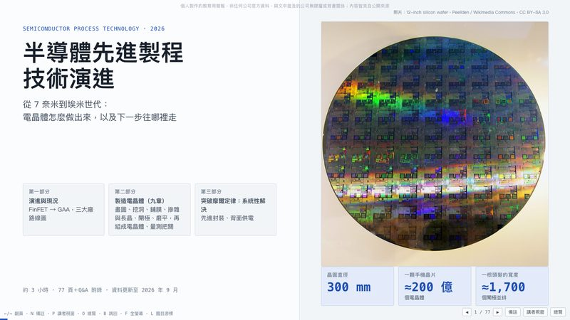
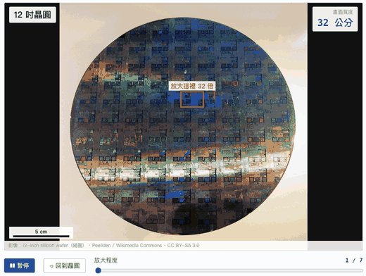
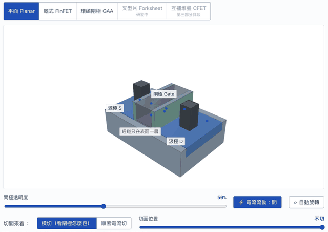
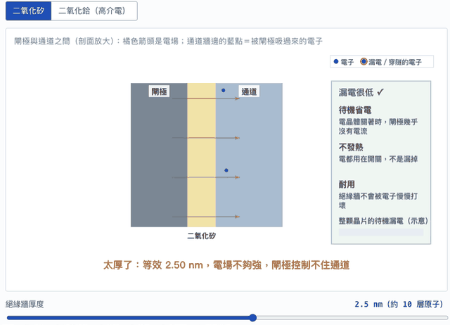
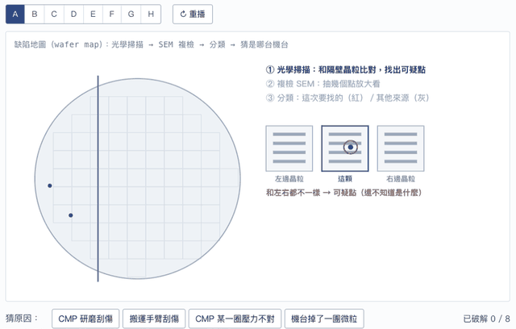
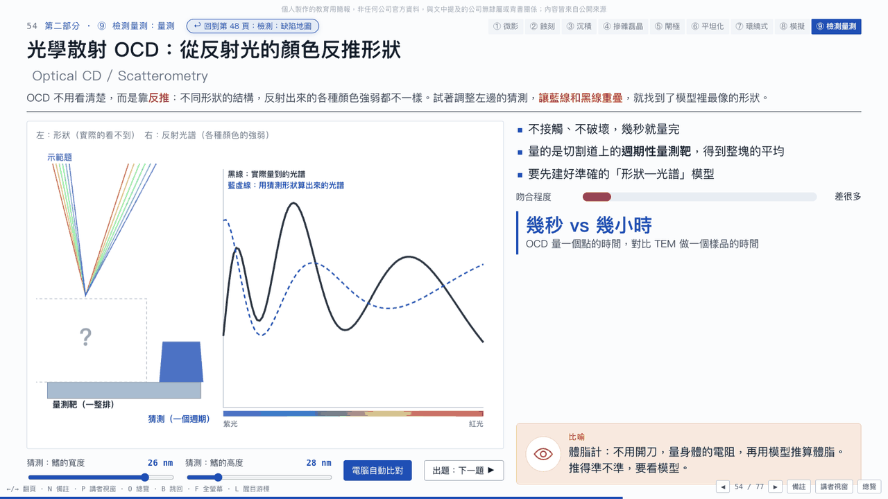
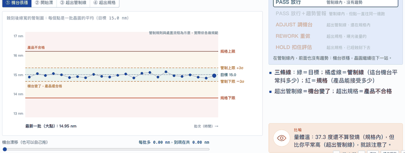

# 先進製程技術演進：互動簡報

給半導體新人的互動式簡報：從電晶體結構演進、九章製程技術（微影、蝕刻、沉積、摻雜與磊晶、閘極、平坦化、環繞式電晶體與導線、模擬、檢測量測），到先進封裝與背面供電。共 77 頁，約 3 小時；每頁左邊是可以動手操作的動畫，右邊是重點與生活比喻，講稿寫在每頁的備註裡。

純前端（HTML／CSS／JavaScript），不需要安裝任何套件、不需要建置就能看。



## 內容一覽

| 部分 | 內容 |
|---|---|
| 第一部分：演進與現況 | 電晶體怎麼開關、縮太小為什麼漏電、Planar → FinFET → GAA → CFET、「2 奈米」名字的真相、三大廠時間軸與成本 |
| 第二部分：製造電晶體（九章） | ① 微影 ② 蝕刻 ③ 沉積 ④ 摻雜與磊晶 ⑤ 閘極 ⑥ 平坦化 ⑦ 環繞式電晶體與導線 ⑧ 模擬（TCAD）⑨ 檢測量測（SPC、APC、TEM、SEM、OCD／RCWA） |
| 第三部分：突破摩爾定律 | 先進封裝（CoWoS、HBM、SoIC、玻璃基板、CPO）、背面供電、CFET 與路線圖 |
| 附錄 | 167 題 Q&A，依主題分類，可跳回相關頁面 |

## 動手玩：幾個例子

**從晶圓到原子**：用真實照片一路放大，右上角顯示畫面實際有多寬。



**結構演進**：3D 模型可以旋轉、切開，看閘極怎麼從「壓住」變成「包住」通道。



**閘極絕緣層**：拖動厚度看電場和漏電的取捨，換成高介電材料後，牆可以做厚、電子卻穿不過去。



**檢測：缺陷地圖**：看缺陷在晶圓上的分布形狀，猜是哪台機台出問題（8 張地圖）。



**OCD 量測**：調整形狀讓模擬光譜對上量到的光譜，也可以讓電腦自動比對，還有出題模式。



**SPC 管制圖**：拖動機台漂移，看判定從放行、趨勢警報、調機台一路走到超出規格；再切換「曝光後量／蝕刻後量」，看同一批是洗掉重做救回來，還是已經挖下去回不來。



## 快速開始

### 方法一：直接開單檔版（最簡單）

```bash
git clone https://github.com/lufor129/Semi_Conductor_Manufactor.git
cd Semi_Conductor_Manufactor
open dist/index.html          # macOS
# Windows：start dist\index.html
# Linux：xdg-open dist/index.html
```

`dist/index.html` 是打包好的單一檔案，圖片已內嵌，直接用瀏覽器開，離線也能看，也可以單獨拷貝給別人。

### 方法二：開原始碼版（要改內容時用）

原始碼版會載入 `js/`、`css/`、`assets/` 底下的檔案，瀏覽器不允許直接用 `file://` 開，需要起一個本機伺服器：

```bash
cd Semi_Conductor_Manufactor
python3 -m http.server 8000
```

然後用瀏覽器開 http://localhost:8000/ 。（沒有 Python 的話，任何靜態伺服器都可以，例如 `npx serve`。）

### 方法三：用 GitHub Pages 放到網路上

到 repo 的 Settings → Pages，Source 選這個分支、資料夾選 `/ (root)`，存檔後約一分鐘就能用 `https://<帳號>.github.io/<repo>/` 開啟（會開原始碼版；單檔版在 `/dist/`）。

建議使用桌面版 Chrome、Edge、Safari 或 Firefox，視窗寬一點效果最好；簡報會自動縮放到 16:9。

## 操作方式

| 按鍵 | 功能 |
|---|---|
| ← ／ → | 上一頁／下一頁 |
| N | 顯示講稿（備註） |
| P | 開講者視窗（另開一個視窗，顯示講稿、下一頁與計時） |
| O | 總覽，可直接跳頁 |
| B | 跳回剛剛的頁面 |
| F | 全螢幕 |
| L | 醒目游標（放大、加亮滑鼠游標） |
| T | 講稿計時歸零 |

- 第二部分右上角的章節列可以直接跳到某一章。
- 每頁左邊的動畫都可以操作：拖滑桿、點按鈕、切分頁。
- 最後一頁是 Q&A 附錄，題目依主題分類，可以跳回相關頁面。

## 修改內容

| 想改的東西 | 檔案 |
|---|---|
| 各頁內容、動畫、講稿（`notes`） | `js/slides/*.js` |
| 頁序 | `index.html` 底部的 `Deck.move(...)` |
| Q&A 題庫 | `docs/qa-by-topic.md`，改完執行 `python3 gen-qa.py` |
| 圖片來源與授權 | `js/credits.js` |
| 樣式 | `css/deck.css` |

改完後重新打包單檔版（需要 Python 3，只用標準函式庫）：

```bash
python3 gen-qa.py          # docs/qa-by-topic.md → js/qa-data.js
python3 build-artifact.py  # 打包成 dist/index.html
```

## 圖片來源與授權

所有照片都是開放授權（CC0、CC BY、CC BY-SA）或公有領域，作者、原始網址與授權條款逐張列在 `js/credits.js`，簡報最後一頁「參考資料與圖片來源」也會列出；標「縮圖」「裁切」的是修改過的版本。沒有開放授權圖片可用的地方，改用程式自繪的示意圖。

`docs/demo/` 裡的截圖與 GIF 是簡報畫面錄製，畫面中出現的照片來源同上。轉用 CC BY-SA 圖片時，請沿用相同授權並標示作者。`vendor/three.min.js` 是 three.js r160（MIT License），版權宣告保留在檔案開頭。

## 授權

- 程式碼與簡報文字：[MIT License](LICENSE)。
- 圖片：依各自的授權（見上一節與 `js/credits.js`），不在 MIT 授權範圍內。
- `vendor/three.min.js`：three.js 的 MIT License。

## 說明

- 數字為業界公開資料或估計，整理至 2026 年 9 月；動畫的數值是教學用的簡化模型，不是精確模擬。
- 文中提到的公司與產品名稱僅用於指稱，商標屬於各自的擁有者。
- 這是個人製作的教育用簡報，使用 Claude 協助製作；不是任何公司的官方資料，與文中提及的公司沒有隸屬或背書關係，內容皆來自公開來源。
